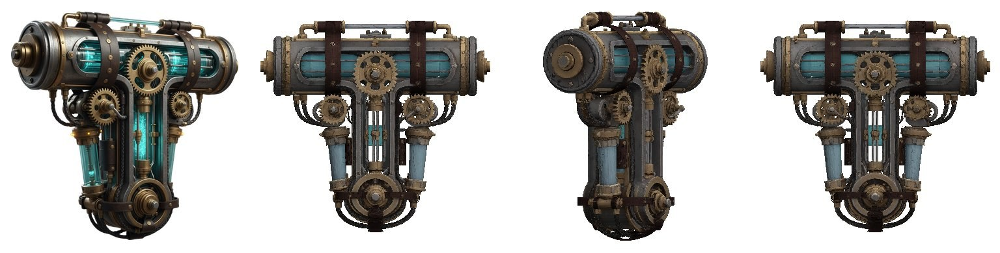

# TRELLIS.2 on Intel Arc Pro B60: image-to-3D with PyTorch XPU, no CUDA

Run Microsoft's [TRELLIS.2](https://github.com/microsoft/TRELLIS.2) image-to-3D model (`TRELLIS.2-4B`) on an **Intel Arc Pro B60** (24 GB) under Linux, using PyTorch's XPU backend in Docker. No NVIDIA GPU, no CUDA and no oneAPI install on the host. One cut-out image goes in, a textured PBR mesh (GLB) comes out.



*Input (left, one of upstream's example images) and the GLB generated at `1024_cascade` on the B60, rendered from three sides.*

Upstream TRELLIS.2 runs only on NVIDIA cards: it calls `.cuda()` directly and depends on the CUDA extensions `flex_gemm`, `o_voxel`, `cumesh`, `nvdiffrast` and `flash_attn`. This port replaces each of them, so the whole image-to-3D pipeline runs on an Intel GPU through `torch.xpu`.

| | |
|---|---|
| Tested GPU | Intel Arc Pro B60, 24 GB, `xe` driver. Other Arc cards (B580, B570, A770) are untested; see the [FAQ](#faq) |
| Stack | `torch 2.15.0+xpu`, `triton-xpu`, compute-runtime 26.35, Level Zero 1.32, in an Ubuntu 24.04 container |
| Pipelines | `512`, `1024`, `1024_cascade`, `1536_cascade`: all 12 benchmark inputs complete at every level |
| Time on the GPU | Median 30 s at `512`, 100 s at `1024` and `1024_cascade`, 300 s at `1536_cascade`, plus CPU post-processing |
| Peak VRAM | 2.6–4.6 GiB at `512`, up to about 20 GiB at the higher levels |
| Output | GLB with 200,000 triangles, base colour and metallic-roughness textures |
| Not ported | Upstream's texturing pipeline, Gradio app, video rendering and training |

This started as a fork of [trellis-mac](https://github.com/shivampkumar/trellis-mac), the Apple Silicon port. The Mac and Metal paths have been removed.

## Requirements

- Linux host with an Intel Arc GPU and the `xe` kernel driver. Only the Arc Pro B60 has been tested. The host needs no oneAPI, Level Zero or PyTorch install: the image carries the whole user-space GPU stack.
- Docker with Compose.
- 30 GB of system RAM has been enough; a run peaks at about 17 GiB, and the container is capped at 26 GiB.
- Disk space for the model weights.
- A Hugging Face read token, with access approved for the gated [DINOv3 weights](https://huggingface.co/facebook/dinov3-vitl16-pretrain-lvd1689m). For the optional SAM 3 background removal, also for the gated [SAM 3 weights](https://huggingface.co/facebook/sam3).

## Setup

```sh
mkdir -p .secrets
printf '%s' 'YOUR_HF_READ_TOKEN' > .secrets/hf_token   # gitignored
chmod 600 .secrets/hf_token

docker compose build trellis
docker compose run --rm fetch-weights                  # the only step with network and token
docker compose run --rm --no-deps cpu-tests            # no GPU needed
```

For SAM 3 background removal, fetch its weights too, after accepting Meta's licence on the Hugging Face page:

```sh
docker compose run --rm fetch-weights /opt/venv/bin/python scripts/fetch_weights.py --with sam3
```

The container needs the host's `video` and `render` group IDs to open the GPU. `compose.yaml` defaults to `983` and `987`; check yours with `getent group video render` and, if they differ, set `VIDEO_GID` and `RENDER_GID` in the environment or in a `.env` file next to `compose.yaml`.

## Generate

Put an image with a **transparent background** in `input/`. An opaque image stops with an error; cut the object out first with `scripts/cutout.py` (below).

```sh
docker compose run --rm trellis /opt/venv/bin/python generate.py \
  /input/object.png --pipeline-type 1024_cascade --output /out/object
```

The result is `out/object.glb`. To preview it without a GPU, render it to a PNG with `scripts/preview.py`.

A run can use nearly all of the card's memory, so stop anything else that is using the GPU first.

| Option | Default | Meaning |
|---|---|---|
| `--pipeline-type` | `512` | `512`, `1024`, `1024_cascade` or `1536_cascade` |
| `--seed` | `42` | Random seed. Results still vary slightly between runs |
| `--target-faces` | `200000` | Triangles in the GLB |
| `--texture-size` | `1024` | `512`, `1024`, `2048` or `4096` |
| `--repair` | `pair` | How non-manifold edges are repaired before baking. `pair` halves the cracks that simplification opens and removes most speckle on cloth and paper, but UV unwrapping takes minutes to an hour instead of seconds. If the simplifier stalls on a paired mesh and flattens it, `pair` falls back to `cut` for that mesh, printing why. `cut` always cuts, for quick previews |
| `--max-tokens` | `49152` | Upper limit on sparse tokens in cascade pipelines |
| `--steps` | model default | Sampler steps for all phases |
| `--no-texture` | off | Write only the raw mesh as OBJ |
| `--save-raw` | off | Also write the raw OBJ, which can reach hundreds of MB, and a `.raw.npz` that `scripts/bake_raw.py` can bake again on the CPU with other options |

### Background removal

`scripts/cutout.py` writes the RGBA image from a photo, using Meta's Segment Anything models. Name the object and each thing it carries for SAM 3, or give nothing and SAM 2 finds a free-standing object on its own:

```sh
docker compose run --rm trellis /opt/venv/bin/python scripts/cutout.py \
  /input/photo.jpg /out/photo.png --prompt farmer basket vegetables
docker compose run --rm trellis /opt/venv/bin/python scripts/cutout.py \
  /input/photo.jpg /out/photo.png
```

Measured on the 12 example images composited over white, grey, gradient and noise backgrounds, against their true alpha:

| | Needs | Mean IoU | Where it fails |
|---|---|---|---|
| SAM 3, `--prompt` | Noun phrases, gated weights | 0.85 | Keeps only what the phrases name: the farmer alone scores 0.72, with "basket" and "vegetables" added 0.98. A generic word like "object" finds nothing |
| SAM 2, no prompt | Nothing | 0.84 | Object and background alike, such as a grey object on grey: 0.2–0.5. Scenes: 0.5–0.7 |
| SAM 2, `--box` | A pixel box | 0.78 | Scenes |

Both take about a second on the GPU. SAM 3 was 848M parameters and about 2 s per image; a plain-PyTorch group norm replaces the XPU kernel that crashed on its mask decoder.

## Choosing a pipeline type

`1024_cascade` is the best balance for solid objects. `512` is the fallback for anything that fails. `1536_cascade` shows little extra detail once baked to 200,000 triangles.

Generation on the GPU takes a median of about 30 s at `512`, 100 s at `1024` and `1024_cascade`, and 300 s at `1536_cascade`. The CPU steps after it usually take longer: with the default `--repair pair` a whole run took a median of 11–12 minutes at every level on the 12 benchmark inputs, from 2 minutes to over an hour, nearly all of it UV unwrapping. `--repair cut` brings a run back to a few minutes. Measurements are in [docs/xpu-measurements.md](docs/xpu-measurements.md).

## Limitations

- **GPU memory:** every benchmark input completes at every level once the allocator is allowed to grow its segments (`PYTORCH_ALLOC_CONF=expandable_segments:True`, set by `generate.py`), with peak VRAM up to 20.2 GiB on the town at `1536_cascade`. Without it, two scene-like inputs failed with gigabytes reserved but unusable. A run that does run out exits with an error rather than hanging.
- **First run:** Triton compiles the convolution kernel on first use, about 10 s once per cache volume.
- **Fine parts:** thin structures can break up or become floating specks.
- **Cracks:** the repair of non-manifold edges cuts the mesh, and simplification then opens the cuts into hairline cracks, which show as speckles on cloth and paper and as small holes at the cascade levels. The default `--repair pair` removes most of them at the price of a slow unwrap; `--repair cut` brings them back together with a fast unwrap. The measurements document records the cause, the fixes that did not work, and the meshes where pairing has to fall back to cutting.
- **Colour:** output is often darker or less saturated than the input. The cause has not been fully traced; see the measurements.
- **Transparency:** glass comes out as an opaque shell.
- **Scenes:** whole rooms and towns only look right from the input's side. The triangle budget is tight for them: at 200,000 triangles the town's facades are a few voxels off the surface over a tenth of their area, which the final decimation stage keeps from turning into triangles that span windows and alleys.

## FAQ

**Does it run on an Arc B580, B570 or A770?** Untested. Nothing in the code is specific to the B60: it needs a GPU that PyTorch exposes as `xpu`. Going by the measured peaks, `512` (2.6–4.6 GiB) should fit a 12 GB card, while the higher levels reached 16–20 GiB on heavy inputs. Please open an issue with your result either way.

**Do I need CUDA, an NVIDIA card or oneAPI?** No. The container installs Intel's compute runtime, Level Zero and the XPU build of PyTorch. The host only provides the kernel driver and `/dev/dri`.

**Upstream fails with `AssertionError: Torch not compiled with CUDA enabled`, or cannot build `flex_gemm`, `cumesh`, `nvdiffrast` or `flash_attn`.** That is what this port fixes: those packages are CUDA-only, and the table below lists what stands in for each.

**`torch.xpu.is_available()` is false in the container.** Check that `/dev/dri` exists on the host and that `VIDEO_GID` and `RENDER_GID` match `getent group video render`. Then run `docker compose run --rm trellis /opt/venv/bin/python scripts/xpu_probe.py`, which reports the device, its memory and any missing operator.

**`torch.OutOfMemoryError: XPU out of memory` or `UR_RESULT_ERROR_OUT_OF_RESOURCES`.** Stop anything else that is using the GPU and try a lower `--pipeline-type`. `generate.py` already sets `PYTORCH_ALLOC_CONF=expandable_segments:True`, which cured the fragmentation failures seen on 24 GB.

**Why does a run take ten minutes when generation takes one or two?** UV unwrapping on the CPU, with the default `--repair pair`. Use `--repair cut` for quick previews.

**Windows, WSL2 or ComfyUI?** Untested and not provided. This is a command-line tool in a Linux container.

**The first TRELLIS, or text-to-3D?** No, only TRELLIS.2 image-to-3D.

**Apple Silicon or AMD?** See [trellis-mac](https://github.com/shivampkumar/trellis-mac) for Macs. This repository has no ROCm path.

## How the port works

| Upstream needs | Here |
|---|---|
| `flash_attn` or `xformers` attention | PyTorch's `scaled_dot_product_attention`, which XPU runs with oneDNN's fused kernel; memory grows linearly with tokens in bf16 and fp16 |
| CUDA sparse convolution (FlexGEMM) | `backends/conv_none.py`: a Triton gather-matmul kernel on XPU, a plain PyTorch loop on CPU and as fallback |
| CUDA mesh extraction (`o_voxel`) | `backends/mesh_extract.py`, plain PyTorch |
| `nvdiffrast` texture baking | `backends/texture_baker.py`, NumPy and xatlas on the CPU |
| CuMesh repair and simplification | `backends/texture_baker.py`: vertex clustering for huge meshes, winding repair, non-manifold vertex splitting, `fast_simplification` to four times the target, then `backends/surface_decimate.py`, a quadric decimator that refuses collapses whose triangles leave the voxel shell |
| RMBG-2.0 background removal | Removed, because of its non-commercial licence. `scripts/cutout.py` offers SAM 3 and SAM 2 instead |

`patches/xpu_compat.py` patches upstream at image build time and fails the build if an expected line is missing. CPU fallback stays disabled, so a missing XPU operator raises an error rather than silently running slowly. GPU containers run with no network.

The design and its reasoning are in [docs/XPU_PORT_PLAN.md](docs/XPU_PORT_PLAN.md).

## Licences and commercial use

The port's own code is MIT. The goal is that nothing in the default pipeline prohibits commercial use of the generated output. `scripts/check_licenses.py` checks the installed packages at build time and the image keeps its inventory in `/opt/app/third-party-licenses.txt`. This is an engineering summary, not legal advice.

- **TRELLIS.2 code and weights:** [MIT](https://github.com/microsoft/TRELLIS.2/blob/main/LICENSE). A residual risk remains around the data the model was trained on.
- **DINOv3 weights:** [Meta's custom licence](https://huggingface.co/facebook/dinov3-vitl16-pretrain-lvd1689m/blob/main/LICENSE.md), gated and with end-use restrictions. Review it before commercial use.
- **Intel runtime components:** Intel's EULA forbids offering them as a hosted service or service bureau. Check this if you plan to run generation as a service for others.
- **SAM 2.1 weights:** [Apache 2.0](https://github.com/facebookresearch/sam2), trained on Meta's own data.
- **SAM 3 weights:** [Meta's SAM License](https://huggingface.co/facebook/sam3), gated and optional. Royalty-free and commercial use is allowed, but it is not an open-source licence: it excludes military and sanctioned uses, must be passed on with any redistribution of the model, and Meta can change it. The SAM 2 path stays as the fallback.
- **Excluded because they forbid commercial use:** RMBG-2.0, `nvdiffrast` and `nvdiffrec`. Do not add them back, and do not import upstream's `o_voxel.postprocess`, which imports `nvdiffrast`. Also excluded: BiRefNet, BEN2, InSPyReNet and u2net, whose MIT or Apache weights were trained on DIS5K or DUTS, datasets whose terms forbid commercial use even of derived work.

## Credits

- [TRELLIS.2](https://github.com/microsoft/TRELLIS.2) by Microsoft Research: the model and codebase
- [DINOv3](https://github.com/facebookresearch/dinov3) by Meta: image features
- [trellis-mac](https://github.com/shivampkumar/trellis-mac) by shivampkumar: the port this fork started from
